# RuralCultureRevitalizationActivities
乡村文化振兴活动推广小程序 
亮点：ECharts运营分析、四级文化协作、活动参与闭环、文化资源传播、六级积分成长、等级权益联动；
角色：用户、省级工作者、市级工作者、县级工作者、乡镇文化工作者、管理员；

所有源码均本人开发，项目是前后端分离的，所有的项目都具备了完整的业务逻辑，不仅仅局限于基础的增删改查（CRUD）操作，系统亮点众多。

本文注重于计算机毕业设计选题指导，列出题目均有源码， 大家可以去【公众号】(毕业终点站)获取或者加我【qq】(2112698948)提意见(别忘记Star哟)。备注：git

声明：仅用于学习使用，请勿用于任何商业行为！

1.系统非商用，非开源，非无偿。

2.由本人开发，如需源码，请联系以下方式，qq:2112698948。

3.项目有很多，并未全部上传，如果未找到想要的，可直接咨询。

# 乡村文化振兴活动推广小程序

> 省、市、县、乡镇四级文化工作者在同一个后台维护辖区内的活动和文化资源，居民在微信小程序里报名、签到、评价、收藏，顺手把自己拍的资料传上来。

## 一、项目简介

做这套系统起因挺实在。乡村文化活动大多靠微信群发通知、现场纸质签到，活动结束以后，谁报名了、谁真到了、哪场活动受欢迎，基本只能凭印象。文化工作者年底想整理一份台账，得翻聊天记录和几张 Excel 对着抄。

系统把这几件事搬到了线上：

- 工作者在后台建活动、传资源，提交给上级审核，驳回的改完再提交；
- 居民在小程序里看活动、报名、到场签到、事后评价，报完名还能取消；
- 报名、签到、评价、收藏都记进积分明细，积分养等级，等级换报名额度和权益；
- 管理员在后台看总量和趋势，按区域、类型、状态筛，账号数据能导出 Excel。

角色分三类：普通用户（微信小程序）、文化工作者（省 / 市 / 县 / 乡镇四级，管理后台）、管理员（管理后台）。

## 二、技术栈

| 层 | 技术选型 |
| --- | --- |
| 后端 | Java 17、Spring Boot 3.3.1、Spring MVC、MyBatis-Plus、MySQL、JWT、Apache POI |
| 管理后台 | Vue 3、Vite、Element Plus、Vue Router、Pinia、Axios、ECharts |
| 小程序 | uni-app、Vue 3、Pinia、微信小程序 API、定位 API、Canvas |
| 架构 | B/S、MVC、前后端分离、小程序端 + 管理后台、多角色与区域数据权限 |
| 开发环境 | Windows、IDEA、JDK 17、Maven、MySQL、Node.js、HBuilderX、微信开发者工具 |

## 三、系统亮点

**1. ECharts 运营分析**
活动统计页顶部三张卡：总浏览量 7,814（看内容曝光）、审核通过 65（进正常流程的活动数）、签到人数 48（实际到场）。下面三张图分开看不同维度：活动类型分布（民俗文化节、非遗传承展演、乡村文艺汇演、农耕文化体验、传统手工技艺培训、乡村阅读推广）、活动状态分布（审核通过 / 待审核 / 审核驳回）、月度活动与报名趋势。排下一季度活动时，先看哪类活动办得多、哪类报名上不去。

**2. 四级文化协作**
省、市、县、乡镇四级文化工作者共用一个后台，登录后只看自己辖区的数据。区域表是四级树，编码沿用行政区划：河南省 410000（省级）→ 郑州市 410100（市级）→ 惠济区 410108（县级）→ 花园口镇 410108100（乡镇级），乡镇级用 9 位码。同级区域用一个「排序」字段控制下拉框里的先后。

**3. 活动参与全流程**
工作者创建活动 → 提交审核 → 管理员通过或驳回（带审核意见）→ 用户报名 → 报名审核 → 现场签到 → 评分评价。签到积分由活动自己设定（截图里是 10 分），报了名没到场的走违约处理，一场活动从发布到收尾的记录都在同一条链上。

**4. 文化资源传播**
图文和视频两类资源，发布前要过审核，过了才能上架。资源详情页记三个数：浏览 / 收藏 / 评论，比如郏县薛店镇那条非遗传承纪实是 225 / 0 / 0，管理员在资源列表里能直接看到每条资源的这三个数，判断哪些内容真的被看。

**5. 六级积分成长**
报名 +5、签到 +10（活动设定）、发表评价 +8、收藏 +3（每日上限 9 分），四条来源都进积分明细。等级从 Lv.1 乡土新人到 Lv.6 乡村文化使者，每级有积分门槛，截图里 105 分对应 Lv.2 乡风访客，进度条显示 105 / 180 还差 75 分升级。

**6. 等级权益联动**
等级不只挂个称号：Lv.1 每月报名上限 3 场，Lv.2 解锁等级标识，往上逐步开放评价图片上传、头像框、荣誉勋章和电子证书，满级用户报名自动审核通过。想多报名就得多参与，逻辑上说得通。

## 四、功能模块

### 4.1 普通用户（微信小程序）

- **账号与个人中心**：注册、账号密码登录、微信登录、微信绑定与解绑、资料和密码修改
- **首页与搜索**：活动与资源浏览、区域选择、分类筛选、全局搜索、公告查看
- **活动参与**：活动详情、在线报名、取消报名、活动签到、评分评价、我的报名与评价记录
- **文化资源**：图文及视频详情、收藏与取消收藏、评论、个人资源上传与管理
- **分享推广**：活动与资源分享、我的分享记录、分享访问统计
- **消息中心**：查看通知、区分已读未读、标记已读
- **积分成长**：积分明细、六级成长、等级加成、月度报名额度、满级自动审核、个人参与趋势、荣誉证书生成与保存

### 4.2 文化工作者（管理后台）

- **分级协作**：省级、市级、县级、乡镇级按所属区域开展管理，数据自动按辖区过滤
- **活动管理**：创建和维护活动、提交审核、驳回后重新提交、管理报名与评价
- **资源管理**：维护文化资源、提交审核、查看评论与互动情况
- **区域统计**：查看权限范围内的活动参与和文化资源统计

### 4.3 管理员（管理后台）

- **账号管理**：管理员、普通用户、文化工作者账号维护，角色与所属区域设置
- **基础资料**：省、市、县、乡镇四级区域管理，活动类型与文化资源类型管理
- **文化活动**：活动信息维护、审核通过或驳回、审核意见、上架下架
- **活动参与**：报名记录、报名审核、签到与违约处理、活动评价管理
- **文化资源**：资源信息维护、图片及视频上传、资源审核、上架下架、评论管理
- **运营管理**：收藏记录、积分记录、公告与消息管理
- **数据看板**：活动参与趋势、区域活跃度、资源访问与互动统计
- **账号导出**：用户账号数据导出为 Excel

## 五、系统截图

### 5.1 登录入口

三个角色共用管理后台登录口（小程序端另有微信登录），账号、密码、角色下拉、验证码四项，账号由管理员统一分配，页面上有这句话。源文档未提供独立的系统总览图，首图即为登录页。

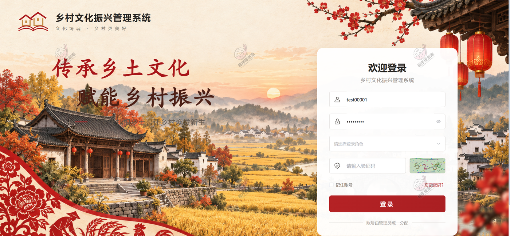

### 5.2 小程序用户端

**首页**：顶部搜索框搜活动和资源，往下是公告条、推荐活动、文化资源卡片，资源卡片上标着浏览数（208、191、225、123）。右图是同一页往下滑的资源展示区。底部四个 tab：首页、活动、消息、我的。

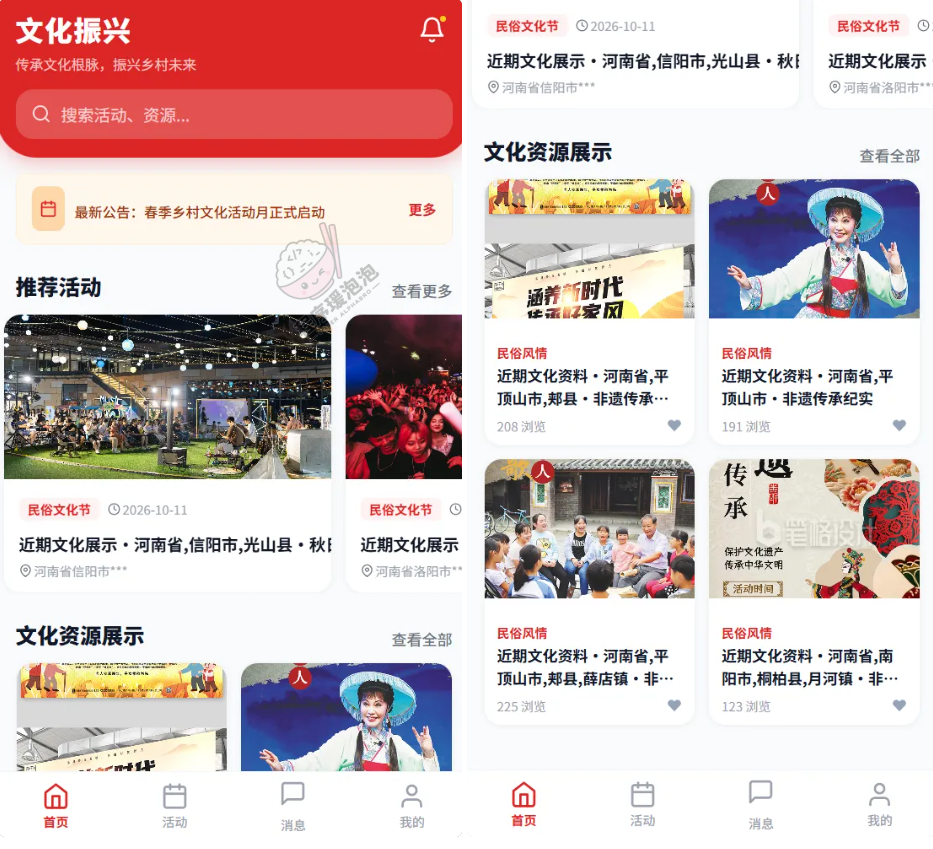

**活动中心与活动详情**：列表按活动类型分 tab（全部 / 民俗文化节 / 非遗传承展演 / 乡村文艺汇演），右上角可按区域筛选，卡片上标「已结束」和时间段。详情页显示活动时间、地点、主办单位、报名人数 0 / 40、签到可得 10 积分，活动结束后底部按钮置灰。

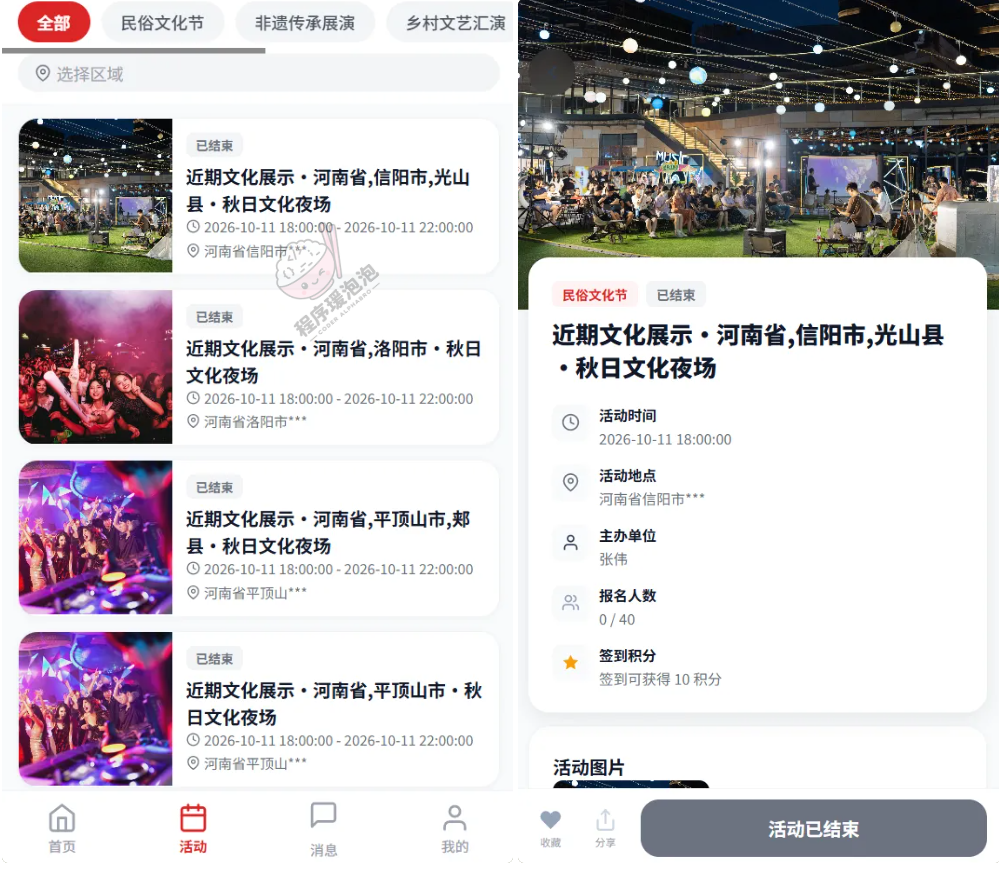

**消息中心与文化资源详情**：消息按系统通知、活动提醒、审核结果分类，报名成功的提醒直接带活动时间，省得回头翻。资源详情页标了层级（乡镇级）、所属区域、上传用户，浏览 / 收藏 / 评论是 225 / 0 / 0。

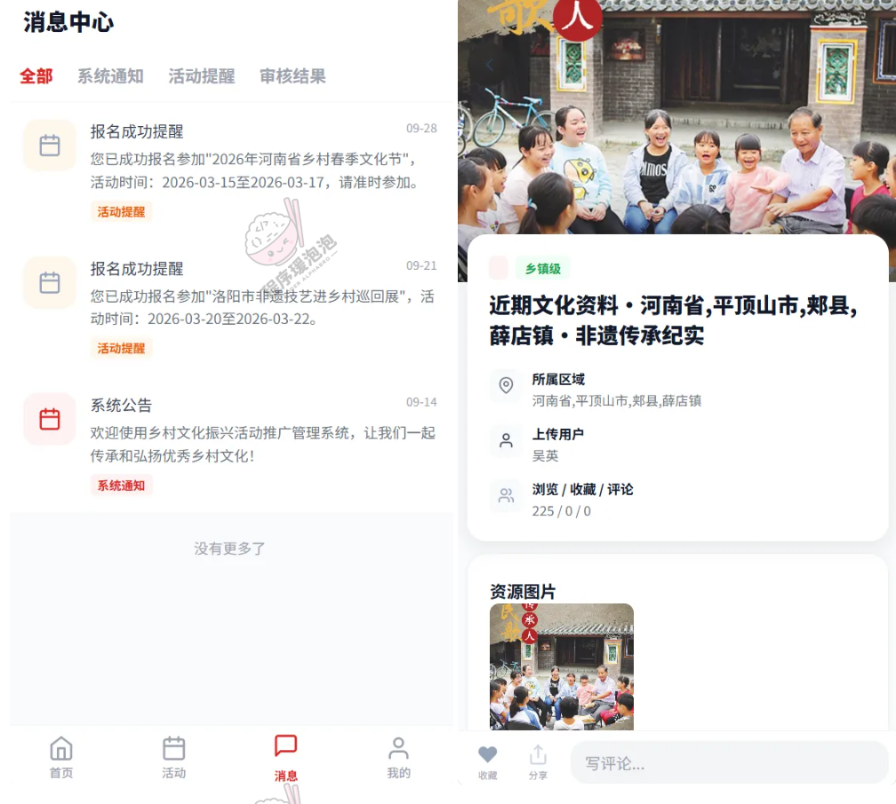

**积分明细与等级规则**：累计 105 分、当前 Lv.2 乡风访客，进度 105 / 180。右边把四种积分来源列清楚：报名 +5、签到 +10、评价 +8、收藏 +3（每日上限 9 分），再往下是各级权益，Lv.1 的权益里写着「每月报名上限：3 场」。

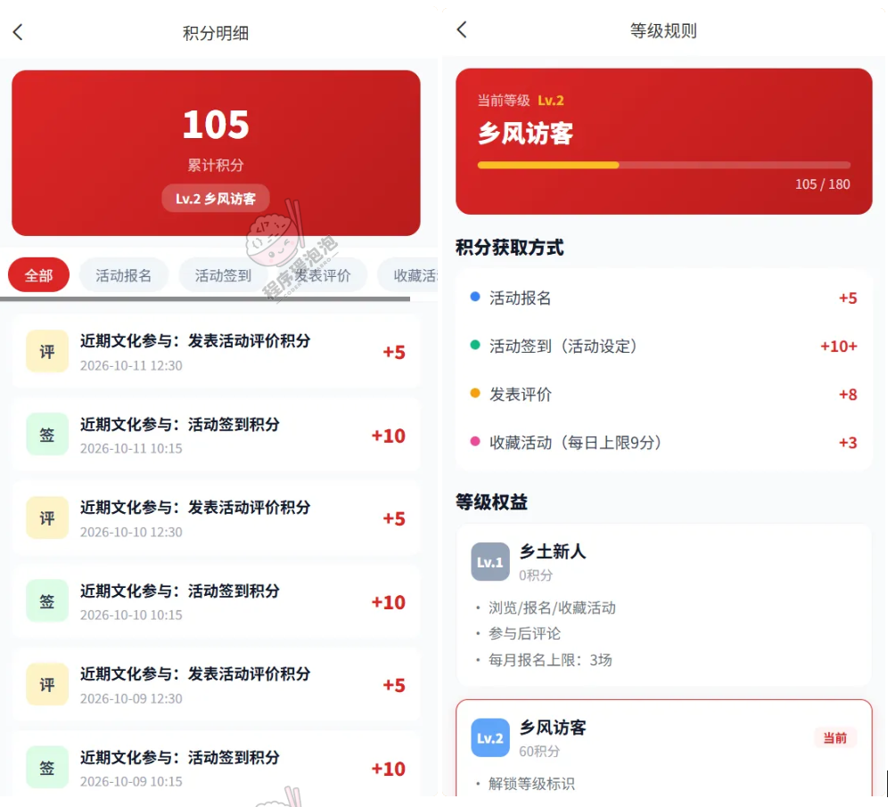

**报名记录与我的评价**：报名记录按状态标出来（待审核 / 审核通过 / 已签到），待审核的可以取消报名，审核通过的可以修改评价。右边是自己的评价列表，带星级和文字，比如「体验时间偏短，期待增加实践环节」。

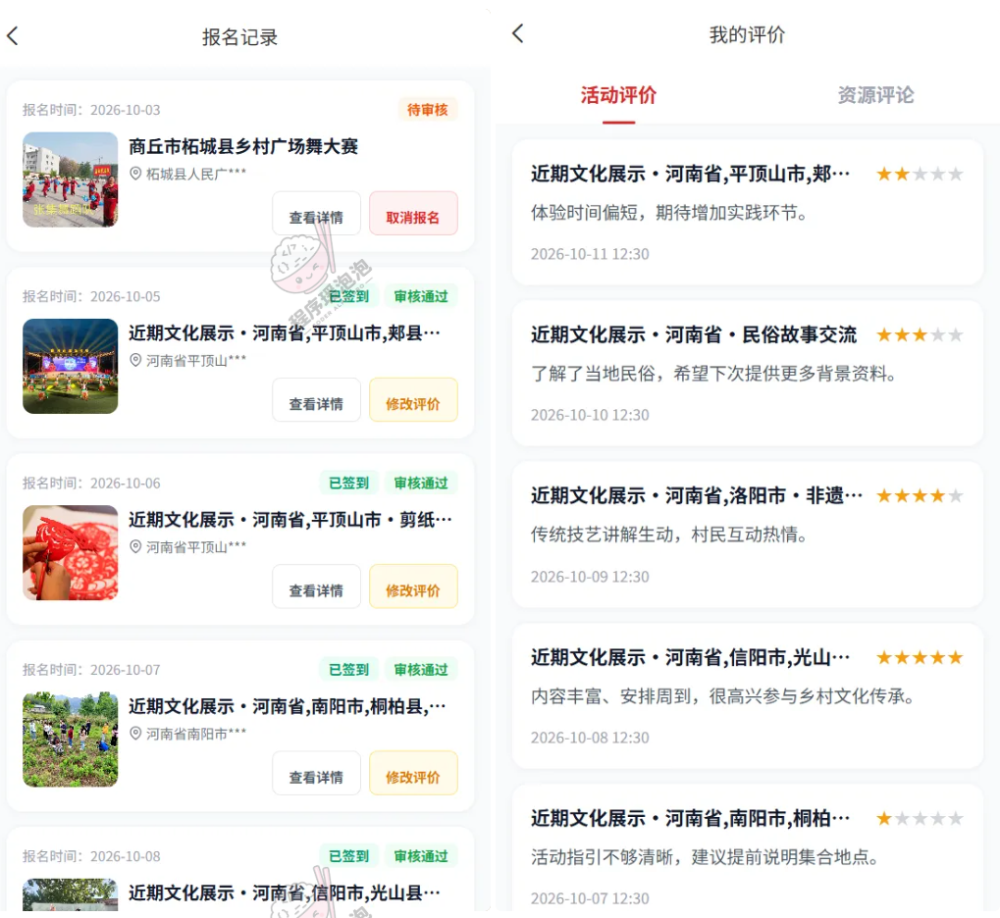

**我的分享与我的收藏**：分享页四个数：总分享 15、被访问 14、其中活动 8、资源 7，下面有近 7 天分享趋势和分享类型占比两张图。收藏页按活动 / 文化资源分类，每条带收藏日期。

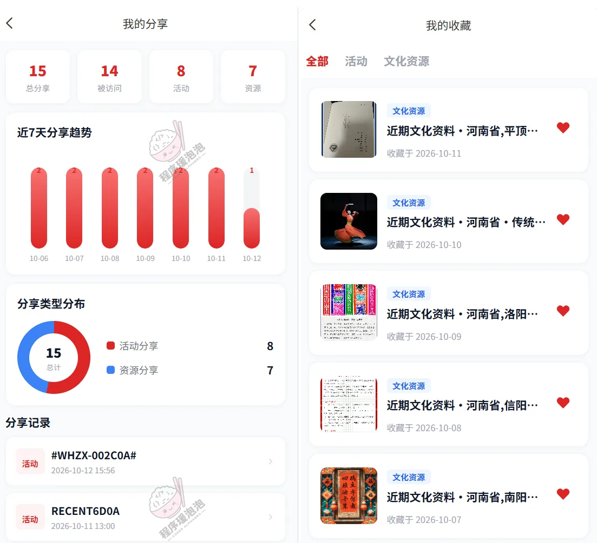

### 5.3 文化工作者端

四个级别各一张，看的都是同一套菜单，区别在「区域」这一列的数据范围。

**省级工作者 · 文化活动**：区域列里同时有省级、市级、县级、乡镇级活动，都在河南省内 —— 省级账号看到的是全省各级的数据。筛选条件有活动标题、活动类型、活动级别、活动状态、上架状态，表里还带封面、报名 / 上限、签到积分。

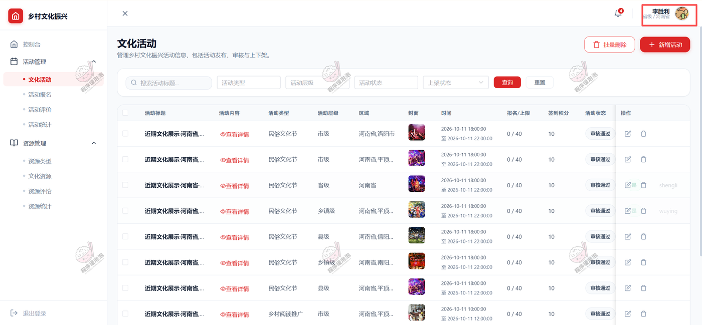

**市级工作者 · 活动报名**：报名列表带用户等级标签（Lv.2 乡风访客、Lv.6 乡村文化使者），待审核的两条给了通过 / 返回两个按钮，审核通过后记录审核人和审核时间。用户等级直接摆在报名表里，审核时能看出是老用户还是新人。

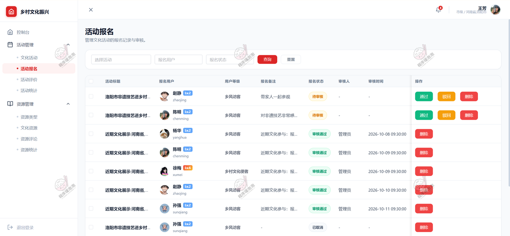

**县级工作者 · 文化活动**：区域列全部收窄到「河南省，信阳…」，本县以外的活动看不到。

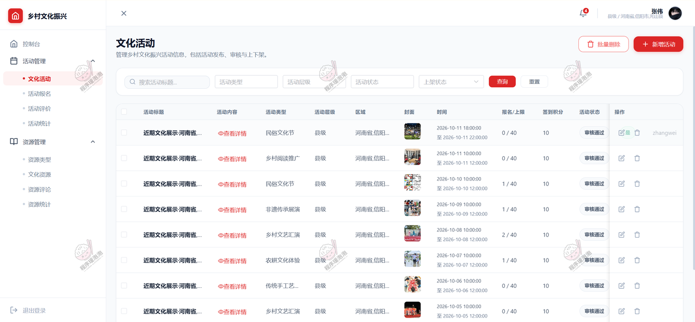

**乡镇工作者 · 文化活动**：区域列收窄到「河南省，南阳…」，活动级别一水儿是乡镇级。

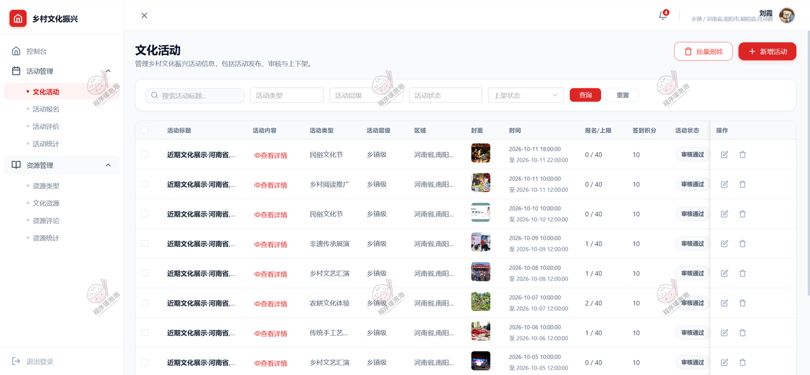

### 5.4 管理员端

管理员和各级工作者共用一套后台，左侧菜单多出账号管理、活动类型、收藏管理、积分记录、公告管理、区域管理这些。「文化活动」列表页与省级工作者是同一画面、同一批全省数据，区别只在菜单和右上角没有「新增活动」按钮 —— 活动由工作者创建提交，管理员负责审核和上下架，所以这里不重复贴图。

**活动报名**：管理员视角能看到全部报名，带用户等级、报名备注、审核人、审核时间，已通过的直接给删除操作。

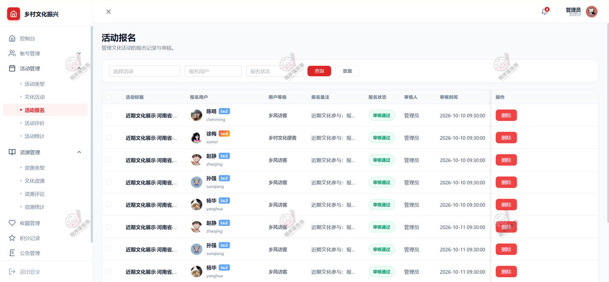

**活动评价**：按活动标题或用户查，每条带星级、评价内容、评价图片列，徐梅那条可以置顶（大概是想把写得好的顶到前面）。

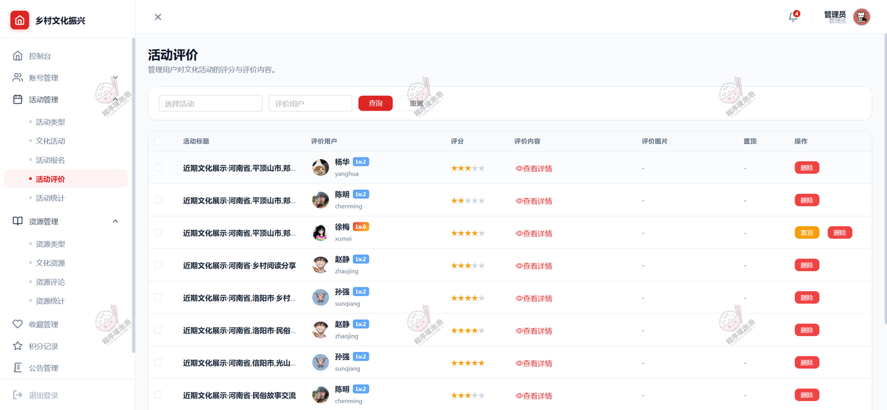

**活动统计**：三张指标卡 + 三张图。类型分布是环形图，状态分布也是环形图（审核通过占绝对多数，待审核和驳回各一小块），下面是月度活动和报名趋势折线。

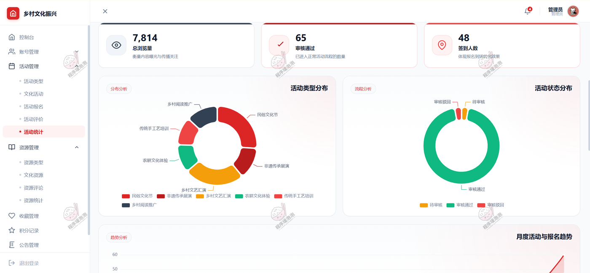

**文化资源**：一条资源一行，列出类型、级别、区域、封面、视频、浏览 / 收藏 / 评论、审核状态、上架开关和上传人。民俗风情和民间音乐两类混着排，按级别能筛出乡镇级的内容。

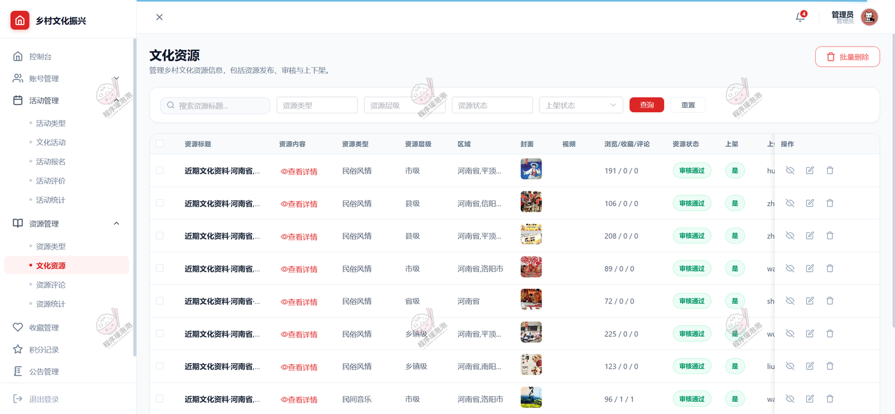

**资源评论**：左边选资源，右边看这条资源下的评论，顶部有「查看原图」能看评论带的图，每条评论带用户名和时间。

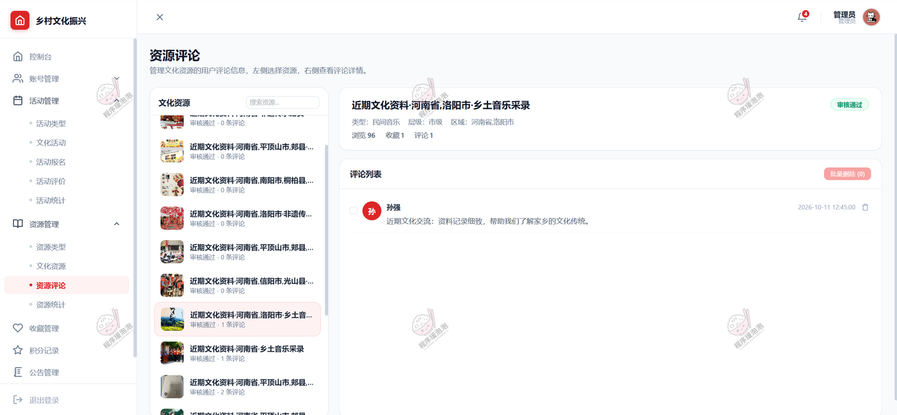

**积分记录**：全站积分流水，用户、积分变动（+5 / +10）、积分类型（发表评价 / 活动签到）、备注、时间都在这张表里，备注写的是「近期文化参与：活动签到积分」这种来源描述，出了问题能倒查。

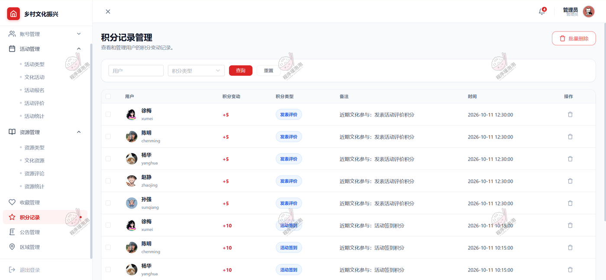

**区域管理**：省、市、县、乡镇四级树形结构，缩进层级一眼能看出来。区域编码沿用行政区划（河南省 410000、郑州市 410100、惠济区 410108、花园口镇 410108100），每行带层级标签和排序值，可以新增下级区域。

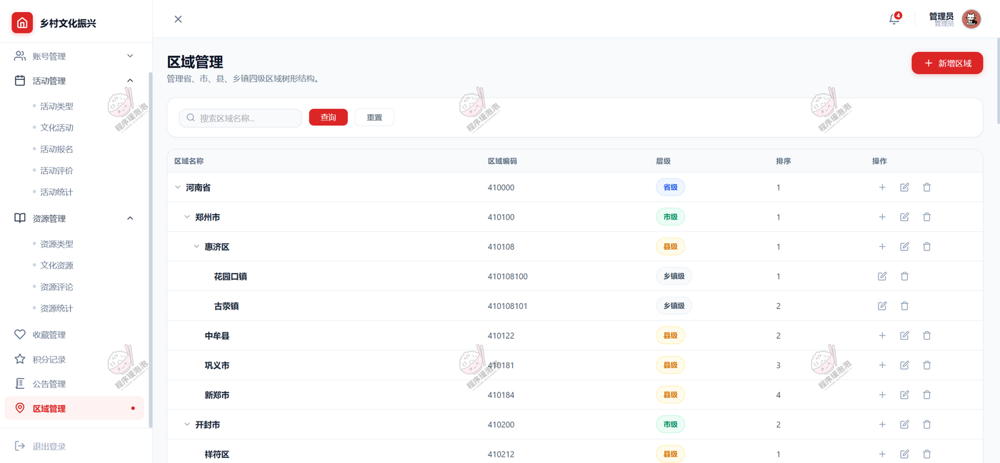

## 六、说明

- 截图中的地名、人名、活动名称均为演示数据，用于展示功能。
- 后台截图统一为 2559 × 1187，小程序截图为双屏拼图，都按原宽展示，避免缩小后文字发虚。
- 文档展示 18 张截图，需要了解更多，请联系我。
